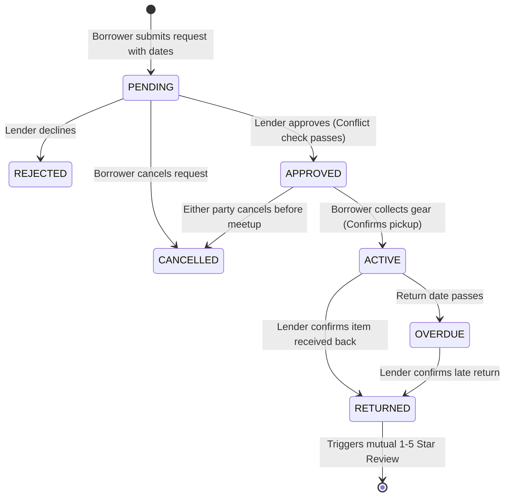

# 🎓 CampusGeeks — Peer-to-Peer Campus Equipment & Resource Sharing Hub

> A verified, localized full-stack sharing economy for college students to lend, rent, and borrow academic equipment (scientific calculators, engineering drafters, lab gear, Arduino kits, textbooks) safely with peer trust ratings and direct WhatsApp handoff coordination.

---

## 📌 1. The Core Problem & Solution

### The Problem
University engineering and science students frequently spend thousands of rupees on academic tools needed for only a few weeks or a single semester (e.g., engineering mini drafters, Casio fx-991 calculators, chemistry lab coats, Raspberry Pi kits). Once exams or semesters finish, these expensive tools sit unused in dorm rooms, while incoming juniors are forced to buy them brand new.

### The Solution: CampusGeeks
**CampusGeeks** connects student lenders and borrowers within the same verified campus community:
* **Lenders** turn idle dorm gear into extra pocket money or give back to juniors through free lending.
* **Borrowers** get immediate, affordable access to essential academic gear without paying retail prices.
* **The Campus** reduces e-waste and promotes sustainability through a circular student economy.

---

## 🚀 2. System Architecture & Tech Stack

```text
┌──────────────────────────────────────────────────────────────────┐
│                   React 18 SPA (Vite + Tailwind CSS)            │
│  - Lucide Icons   - AuthContext (JWT)   - Responsive Mobile UI   │
│  - Axios Client with Interceptors       - Dynamic Price Calc     │
└─────────────────────────────────┬────────────────────────────────┘
                                  │ HTTP / JSON / HTTP-only Cookies
                                  ▼
┌──────────────────────────────────────────────────────────────────┐
│                   Node.js & Express.js REST API                  │
│  - JWT Auth (bcryptjs)                  - Central Error Handler  │
│  - State Machine Lifecycle Engine       - Date Overlap Validator │
│  - Multer & Cloudinary Image Uploads    - Role-Based Middlewares │
└─────────────────────────────────┬────────────────────────────────┘
                                  │ Mongoose ODM
                                  ▼
┌──────────────────────────────────────────────────────────────────┐
│                        MongoDB Database                          │
│  - Users Collection                     - Items (Text Indexed)   │
│  - BorrowRequests (State Machine)       - Reviews (Trust Rating) │
└──────────────────────────────────────────────────────────────────┘
```

### Technology Breakdown:
* **Frontend:** React 18, Vite, Tailwind CSS, Lucide React, Axios, React Router v6.
* **Backend:** Node.js (v20+), Express.js (Modular MVC architecture).
* **Database:** MongoDB with Mongoose ODM (Compound indexes & Full-text search).
* **Security:** `bcryptjs` (salt rounds: 10), JSON Web Tokens (JWT) stored in secure `httpOnly` cookies.
* **Image Management:** Cloudinary SDK with automatic local Data-URI fallback for zero-config development.
* **Testing:** Node.js native test runner (`node:test` and `node:assert`) with isolated test databases.

---

## 🔄 3. The Borrow Request State Machine

Instead of basic CRUD, every equipment transaction is governed by a strict, role-validated **finite state machine**:



### State Transition Rules:
| Current Status | Target Status | Allowed Role | Side-Effect on Item |
| :--- | :--- | :--- | :--- |
| `PENDING` | `APPROVED` | **Lender** | Verifies no overlapping reservation exists |
| `PENDING` | `REJECTED` | **Lender** | Request terminated |
| `PENDING` | `CANCELLED` | **Borrower** | Request terminated |
| `APPROVED` | `ACTIVE` | **Borrower** | Item status set to `BORROWED` |
| `ACTIVE` | `RETURNED` | **Lender** | Item status restored to `AVAILABLE` |
| `RETURNED` | *(Review)* | **Both** | Updates peer `trustScore` & `totalReviews` |

---

## 🗄️ 4. Database Schema Design

### 1. `User` Schema
```javascript
{
  name: { type: String, required: true },
  email: { type: String, required: true, unique: true, index: true },
  password: { type: String, required: true, select: false },
  collegeId: { type: String, required: true },     // Student Roll No
  department: { type: String, required: true },    // Academic branch
  phone: { type: String, required: true },         // WhatsApp handoff contact
  trustScore: { type: Number, default: 5.0 },      // Calculated average rating
  totalReviews: { type: Number, default: 0 },
  totalLends: { type: Number, default: 0 },
  totalBorrows: { type: Number, default: 0 }
}
```

### 2. `Item` Schema
```javascript
{
  title: { type: String, required: true, maxlength: 100 },
  description: { type: String, required: true, maxlength: 1000 },
  category: { 
    type: String, 
    enum: ["Electronics & Kits", "Lab Gear", "Textbooks & Notes", "Drafting & Tools", "Sports & Events", "Other / General"],
    index: true 
  },
  condition: { type: String, enum: ["Brand New", "Like New", "Good", "Fair"] },
  images: [{ type: String }],
  owner: { type: ObjectId, ref: 'User', required: true, index: true },
  pricingType: { type: String, enum: ["FREE", "RENT_PER_DAY"], default: "FREE" },
  pricePerDay: { type: Number, default: 0 },
  depositAmount: { type: Number, default: 0 },
  status: { type: String, enum: ["AVAILABLE", "BORROWED", "UNAVAILABLE"], default: "AVAILABLE", index: true },
  pickupLocation: { type: String, default: "Central Library / Main Gate" }
}
// Indexes: Compound Text on { title, description }; Compound on { category, status, createdAt }
```

### 3. `BorrowRequest` Schema
```javascript
{
  item: { type: ObjectId, ref: 'Item', required: true, index: true },
  lender: { type: ObjectId, ref: 'User', required: true, index: true },
  borrower: { type: ObjectId, ref: 'User', required: true, index: true },
  startDate: { type: Date, required: true },
  endDate: { type: Date, required: true },
  totalDays: { type: Number, required: true },
  estimatedCost: { type: Number, default: 0 },
  depositAmount: { type: Number, default: 0 },
  purpose: { type: String, maxlength: 300 },
  status: { 
    type: String, 
    enum: ["PENDING", "APPROVED", "REJECTED", "ACTIVE", "RETURNED", "CANCELLED", "OVERDUE"],
    default: "PENDING", 
    index: true 
  },
  handoverDate: { type: Date },
  actualReturnDate: { type: Date }
}
```

### 4. `Review` Schema
```javascript
{
  request: { type: ObjectId, ref: 'BorrowRequest', required: true, index: true },
  reviewer: { type: ObjectId, ref: 'User', required: true },
  reviewee: { type: ObjectId, ref: 'User', required: true, index: true },
  roleOfReviewee: { type: String, enum: ['LENDER', 'BORROWER'] },
  rating: { type: Number, min: 1, max: 5, required: true },
  comment: { type: String, maxlength: 500, required: true }
}
// Index: Compound Unique on { request: 1, reviewer: 1 } (prevents duplicate reviews)
```

---

## 📡 5. RESTful API Specification

### Authentication (`/api/auth`)
| Method | Endpoint | Access | Description |
| :--- | :--- | :--- | :--- |
| `POST` | `/api/auth/register` | Public | Register new student, hashes password & sets JWT cookie |
| `POST` | `/api/auth/login` | Public | Authenticates credentials & sets JWT cookie |
| `POST` | `/api/auth/logout` | Public | Clears HTTP-only JWT cookie |
| `GET` | `/api/auth/me` | Protected | Returns current authenticated student profile |
| `PUT` | `/api/auth/profile` | Protected | Update profile (department, phone, avatar) |

### Equipment Listings (`/api/items`)
| Method | Endpoint | Access | Description |
| :--- | :--- | :--- | :--- |
| `GET` | `/api/items` | Public | Catalog with search, category, condition, pricing filters & pagination |
| `GET` | `/api/items/:id` | Public | Detailed item specs with populated owner trust profile |
| `POST` | `/api/items` | Protected | Create new listing with multi-image upload (Multer) |
| `PUT` | `/api/items/:id` | Owner Only | Update item details (blocked if actively borrowed) |
| `DELETE` | `/api/items/:id` | Owner Only | Delete listing (blocked if actively borrowed) |
| `GET` | `/api/items/user/my-listings` | Protected | Get all listings created by the current student |

### Borrow Requests (`/api/requests`)
| Method | Endpoint | Access | Description |
| :--- | :--- | :--- | :--- |
| `POST` | `/api/requests` | Protected | Submit request with dates (blocks self-borrowing & overlaps) |
| `GET` | `/api/requests/borrower` | Protected | Get all outgoing borrow requests made by the user |
| `GET` | `/api/requests/lender` | Protected | Get all incoming borrow requests for the user's items |
| `GET` | `/api/requests/:id` | Participant | Get single borrow request details |
| `PATCH` | `/api/requests/:id/status` | Participant | State machine transition (`APPROVED`, `ACTIVE`, `RETURNED`) |

### Peer Reviews (`/api/reviews`)
| Method | Endpoint | Access | Description |
| :--- | :--- | :--- | :--- |
| `POST` | `/api/reviews` | Protected | Submit 1-5 star review for completed (`RETURNED`) requests |
| `GET` | `/api/reviews/user/:userId`| Public | Get all reviews and comments received by a student |

---

## ⚙️ 6. Local Setup & Installation Guide

### Prerequisites
* **Node.js** v18+ (tested on v24.16.0)
* **MongoDB** running locally on port 27017 or a MongoDB Atlas connection string

### 1. Clone & Enter Project
```powershell
cd campusgeeks
```

### 2. Configure Backend (`server/`)
```powershell
cd server
npm install
```

Create `server/.env` (or copy from `server/.env.example`):
```env
PORT=5000
NODE_ENV=development
MONGO_URI=mongodb://127.0.0.1:27017/campusgeeks
JWT_SECRET=campusgeeks_super_secret_jwt_key_2026_change_in_production
JWT_EXPIRES_IN=7d
CLIENT_URL=http://localhost:5173

# Optional: Cloudinary Keys (If omitted, automatic local Data-URI storage is used)
CLOUDINARY_CLOUD_NAME=
CLOUDINARY_API_KEY=
CLOUDINARY_API_SECRET=
```

Start the backend dev server:
```powershell
npm run dev
```
*(Server will start on `http://localhost:5000` with health check at `http://localhost:5000/api/health`)*.

### 3. Configure Frontend (`client/`)
In a new terminal window:
```powershell
cd client
npm install
npm run dev
```
*(Vite dev server will start at `http://localhost:5173`)*.

---

## 🧪 7. Automated Test Suite

CampusGeeks includes an automated integration test suite written with Node's native test runner (`node:test`) covering all security, routing, conflict detection, and state machine transitions:

```powershell
cd server
npm test
```

### Test Coverage Summary:
* ✔ **8 Authentication Tests:** Registration, duplicate email rejection, missing field validation, password hashing, invalid credentials, protected route rejection, Bearer token hydration, and cookie logout.
* ✔ **3 Health Check Tests:** Root API info, health uptime check, and 404 handler.
* ✔ **9 Item & Catalog Tests:** Unauthenticated creation block, authenticated creation, paginated catalog, category filters, single item hydration, non-owner update rejection (403), owner update, non-owner deletion rejection (403), and owner deletion.
* ✔ **8 Borrow Request & State Machine Tests:** Self-borrowing rejection (400), invalid date range rejection (400), request creation (`PENDING`), borrower approval rejection (400), lender approval (`APPROVED`), overlapping date reservation conflict (409), borrower pickup confirmation (`ACTIVE`), and lender return confirmation (`RETURNED`).
* ✔ **4 Peer Review Tests:** Premature review rejection (400), successful review submission, dynamic `trustScore` mathematical recalculation, duplicate review prevention (400), and public user review fetching.
* **Total: 37 tests passing (100% green).**

---

## 🛡️ 8. Security & Production Best Practices

1. **Password Security:** Salted and hashed using `bcryptjs` with 10 salt rounds before persisting to MongoDB. Passwords are never returned in JSON queries (`select: false`).
2. **HTTP-Only Cookies:** JWT tokens are transported in `httpOnly` cookies with `SameSite=Strict`, mitigating Cross-Site Scripting (XSS) and Cross-Site Request Forgery (CSRF).
3. **Double-Booking Prevention:** A mathematical overlap algorithm checks existing reservations before approving a request to prevent two students from booking the same calculator or lab gear during overlapping dates.
4. **Role & Ownership Enforcement:** Every state transition and item edit validates that `req.user._id` matches the required role (owner, lender, or borrower).
5. **Sanitized Error Handling:** Centralized Express error middleware prevents internal stack traces and database connection strings from leaking to end users in production.

---

## ☁️ 9. Deployment Guide

### Frontend Deployment (Vercel)
1. Push the code to a GitHub repository.
2. Link the repository to [Vercel](https://vercel.com).
3. Set the **Root Directory** to `client`.
4. Add environment variable:
   * `VITE_API_URL=https://your-backend-service.onrender.com/api`
5. Click **Deploy**.

### Backend Deployment (Render / Railway)
1. Link your GitHub repository to [Render](https://render.com).
2. Create a new **Web Service** with **Root Directory** set to `server`.
3. Build Command: `npm install`
4. Start Command: `node src/server.js`
5. Configure Environment Variables:
   * `PORT=5000`
   * `NODE_ENV=production`
   * `MONGO_URI=mongodb+srv://<user>:<password>@cluster.mongodb.net/campusgeeks`
   * `JWT_SECRET=<random-64-char-string>`
   * `CLIENT_URL=https://your-frontend.vercel.app`
   * `CLOUDINARY_CLOUD_NAME=<your_cloud_name>`
   * `CLOUDINARY_API_KEY=<your_api_key>`
   * `CLOUDINARY_API_SECRET=<your_api_secret>`

---

## 🔮 10. Future Roadmap (Post-Minor Project)
* **Automated Late Fees:** Daily penalty fee deduction if an item is not marked `RETURNED` past its scheduled return date.
* **Real-Time Push Notifications:** WebSocket/Socket.io alerts when a lender approves or rejects a request.
* **Student ID OCR Scanning:** Tesseract.js optical character recognition to verify physical college ID cards during registration.

---

## 👥 Contributors & Academic Acknowledgments
* **Author:** Computer Engineering Student Developer
* **Project Type:** Full-Stack MERN Minor Project
* **License:** ISC
